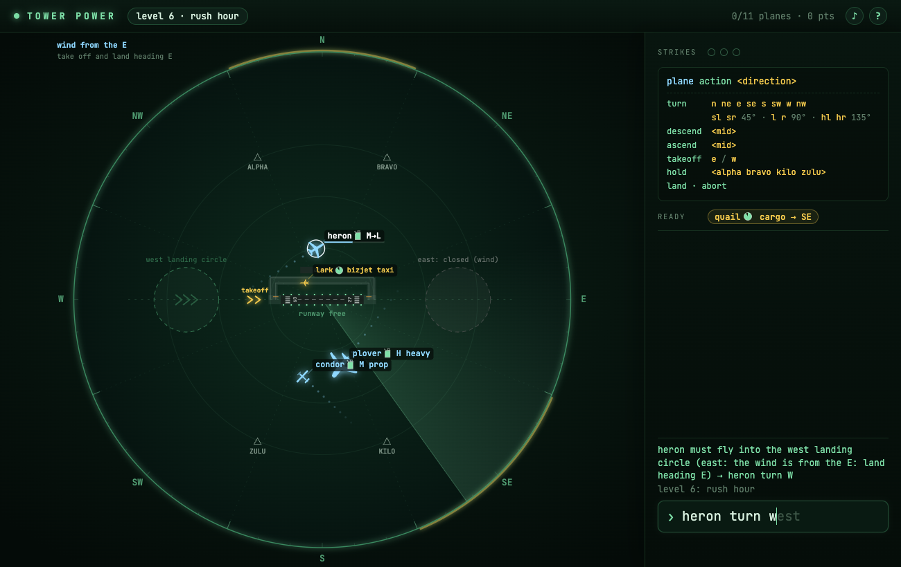

# Tower Power

### ▶ [Play Tower Power in your browser](https://louisvandenbruwaene.github.io/tower/)

No install, no account: open the link, click into the prompt and type.

[](https://louisvandenbruwaene.github.io/tower/)

Air traffic control, very realistic in spirit but highly simplified, played only by typing words, as a roguelike **career**. You fly 3-minute shifts at an airport and pay rent every week, rent that grows 30% a week (and faster after week 5). Can't pay: **broke**, the career is over. Hold 8 weeks of rent at the end of a week and you may **retire**: the win. A normal career is about an hour, a speedrun 20 minutes, and inflation ends even the best one within about two and a half hours.

**The radar.** Arrivals (blue) come in high: bring them down low, into a landing circle off a runway end, and land them. Departures (gold) take off and leave through their own slice of the circle. A crash (two aircraft touching less than 400 ft apart, a storm cell, a mountain below mid, an empty tank) gets you **fired**; so do too many **write-ups** in one shift (a wrong exit, a lost arrival, a cancelled departure, a late priority flight, closed airspace).

**The job.** Every shift gets a review (A, B or C). Two A reviews bring a promotion: either a harder sector of your own (Senior I, II, III) or intern screens to supervise (Supervisor 2, Senior Supervisor 4, Chief 6 screens in a grid), where the interns make realistic mistakes (forgetting a plane, reacting late, a slip of the tongue) that you fix by typing to their planes. Three A reviews pay a performance bonus, cash or a rare tattoo. Every week the job board offers other airports, up to the tier your reputation reaches: ten of them, from a grass strip to Meridian Hub, each with its own runways, traffic, weather, closed airspace and a season. Fired means back to intern at a small airport, cash and tattoos kept.

**The shop.** After every shift: three pieces of kit (yours for the career, 20 kinds: Stopwatch, Thermos, Weather Radio…) and two favours, typed once in a shift: `groundstop`, `expedite heron`, `vector`, `standby`, `freeze`, `cleanup`, `double heron`, `tailwind`. Restocking costs a little.

**The devil.** Rare: at the end of every 2nd week he offers three tattoo sketches to choose one from, free, drawn on your body in blood. 38 tattoos in 7 styles change the rules and the pay (every plane pays Fare × Mult); most strong ones carry a catch (Eye of the Storm compounds ×1.1 per storm while every storm grows), some a sacrifice (a strike, your eyes, your rank, your soul). The same style on both arms or both hands is 1.5× as strong, and 2 or 4 of a style add its mark.

Extra information (what is special about an airport, its season) comes as a text from your supervisor or boss, not on the cards.

**Between careers.** Milestones (your first MEDEVAC, a streak of 25, Chief with 6 screens, retiring within 30 minutes…) give skill points for a skill tree that buys information and comfort, never pay: path lines, conflict markers, warnings, slow motion, pauses, chained and group orders, interns who call for help. `daily` plays today's career, seeded the same for everyone, without skills.

Every command is `plane action [direction]`, in any capitals:

```
heron turn s              # n ne e se s sw w nw
heron turn l              # sl sr = 45°, l r = 90°, hl hr = 135°
heron descend             # down to low (descend mid, descend 4 or descend 4000 stop higher)
heron ascend              # up as high as it goes (ascend mid stops at mid)
heron hold                # circle on the spot (hold kilo: at the fix KILO)
heron land                # inside an open landing circle: it turns onto the runway there
wren takeoff e            # taxi out, take off east, climb to mid and fly straight on
owl land                  # a helicopter: to the nearest free helipad
groundstop                # a favour from the shop (typed in full)
pause                     # with the Pause skills: time stops, the radar stays (Esc: the plain pause)
speed · sound · aircraft · tutorial · help
```

A unique start of a word is enough, faded text in the prompt is a suggestion (→ takes it all, Tab one word), typos are fixed at once (nt = north), and shortcuts work (`heron n`, `heron down`, `wren e`). Every screen of a supervisor has its own call signs (birds, trees, rivers, stars, stones, fish), so an order goes to the right screen by itself. A short tutorial sits behind the **tutorial** button, between shifts. One self-contained HTML file, no build step: open [`index.html`](index.html).

## Play on this Mac

```
./app/install_app.sh   # puts Tower Power in /Applications
./app/make_icon.sh     # only needed after editing app/icon.html
```

Dev: `index.html#dev` exposes `window.G` (the state, the shift, the career, `step` for every screen, `exec`, `run`, `decide` for the built-in controller, `choose` for the career screens) for headless tests. Typing `admin fly` opens a sandbox; `career cash 50000`, `career tattoo jumbo`, `career rank super6` and the like set up a career to test.

## The code

**What:** the whole game is the script in `index.html`: the simulation (traffic, weather, planes that turn, climb and land at realistic rates), reading what you type, and drawing the radar.
**Why one file:** no build step and no libraries; open it and it runs, in a browser or in the Mac app.
**How it is laid out:** numbered sections, listed at the top of the script; search for `§ 1` … `§ 16`. **§ 1 SETTINGS holds every number and piece of content that decides how the game plays** (speeds, distances, aircraft types, traffic, weather, money, the airports, ranks, rent, seasons, the tattoos and shop kit with their numbers and drawings, favours, interns, the skill tree, milestones), in real units with a comment each: change the game there. § 2 converts them to game units, § 3–§ 10 are the simulation (§ 4 the career's saves and the worlds, one per radar screen; § 6b the tattoos and Fare × Mult; § 9b the interns), § 11–§ 13 the prompt, tutorial and admin, § 14–§ 15 drawing and the screens between shifts (the review, jobs, the shop, the devil), § 16 starts it all.
