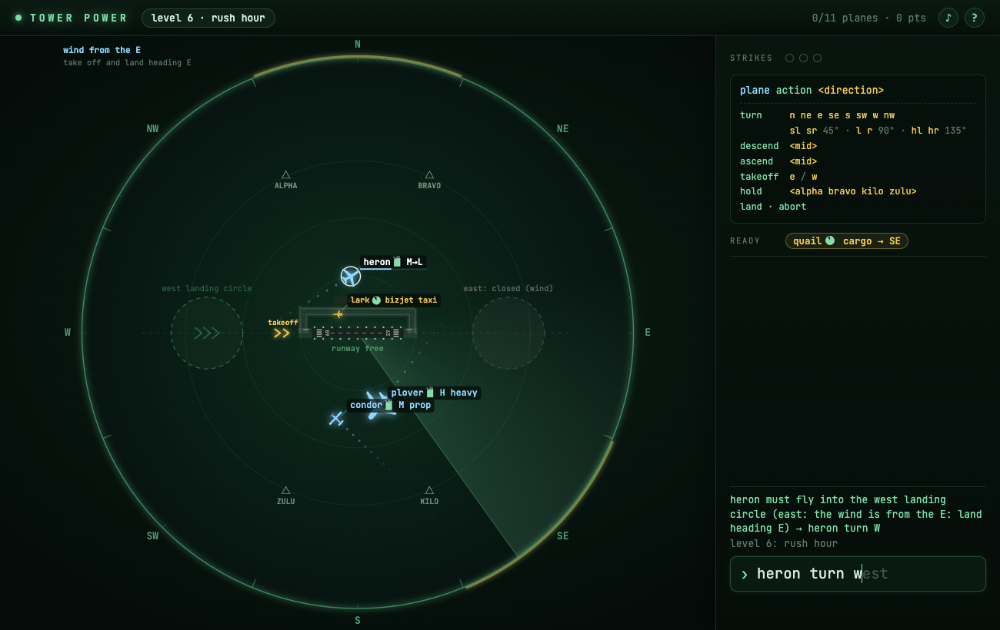

# Tower Power

### ▶ [Play Tower Power in your browser](https://louisvandenbruwaene.github.io/tower/)

No install, no account: open the link, click into the prompt and type.

[](https://louisvandenbruwaene.github.io/tower/)

Air traffic control, very realistic in spirit but highly simplified, played only by typing words. Your area is the radar circle. Arrivals (blue) come in high; bring them down low and fly them into one of the two landing circles off the runway ends, then land: they turn onto the runway by themselves. Departures (gold) each want to leave in one of 8 directions: take them off east or west down the runway, then turn them so they leave the circle through their own slice. Same level and too close, a departure leaving through the wrong slice, or an arrival leaving your area: strike. Three strikes end the shift.

Every command is `plane action [direction]`, in any capitals:

```
heron turn s              # n ne e se s sw w nw
heron turn l              # sl sr = 45°, l r = 90°, hl hr = 135°

heron descend             # down to low (descend mid stops at mid)
heron ascend              # up to high (ascend mid stops at mid)
heron hold                # circle on the spot until a turn (or land, inside a landing circle)
heron hold kilo           # fly to a holding fix (alpha bravo kilo zulu) and circle there
heron land                # only inside an open landing circle: it turns onto the runway there
wren takeoff e             # e or w; it taxis out, waits for a free runway, climbs to mid and flies straight on
buy nav                   # after a shift: spend tokens on upgrades (height runway nav tanks)
daily                     # today's seeded shift, the same for everyone
speed                     # time runs 1×, 2×, 4×, 8× and back (or the 1× button)
sound                     # sound effects on/off (or the ♪ button)
aircraft                  # the data sheet: every aircraft type's real model, weights, speeds, turn, climb, runway, fuel
```

A unique start of a word is enough, faded text in the prompt is a suggestion (→ takes it all, Tab one word), and typos are fixed at once (nt = north), the reply showing what was understood. The first visit opens a short `tutorial` (a landing, a departure, a hold; `skip` leaves it, `tutorial` replays it), then you are in the shift, its first five planes in slow motion, then full speed. Every rule is on from the start: aircraft types (prop, jet, bizjet, heavy, each with its own speed, turn rate and pictogram, and wake turbulence behind a heavy), fuel and MAYDAYs, wind that sets the runway direction, readback errors and drifting storm cells. The shift never ends (the traffic stops growing after 15 minutes): three strikes pay tokens for the score (100 per plane, less the delay, plus a streak bonus of +10 per plane in a row without a strike, up to +50), spent on upgrades for later shifts, bought in small steps at 10, 20, 50, 100, 200 tokens (tanks, height, nav, runway). A shift of 1000 points unlocks `hard`: no autopilot, `land` only works for a plane you have flown onto the runway's line yourself (low, facing the runway, at most 450 m off the centreline, runway free), and `hold alpha` only once it is at ALPHA. After 10 planes, overflights from the neighbouring sector join in. Waiting is shown on the radar: a bar for level changes, a dashed line for turns, an amber runway while it is busy. `demo` shows a built-in controller playing (it types into the real prompt and says why). What is in and what is still to come is listed in [IDEAS.md](IDEAS.md). One self-contained HTML file, no build step: open [`index.html`](index.html).

## Play on this Mac

```
./app/install_app.sh   # puts Tower Power in /Applications
./app/make_icon.sh     # only needed after editing app/icon.html
```

Dev: `index.html#dev` exposes `window.G` (S, step, exec, run, decide, startShift…) for headless tests.
